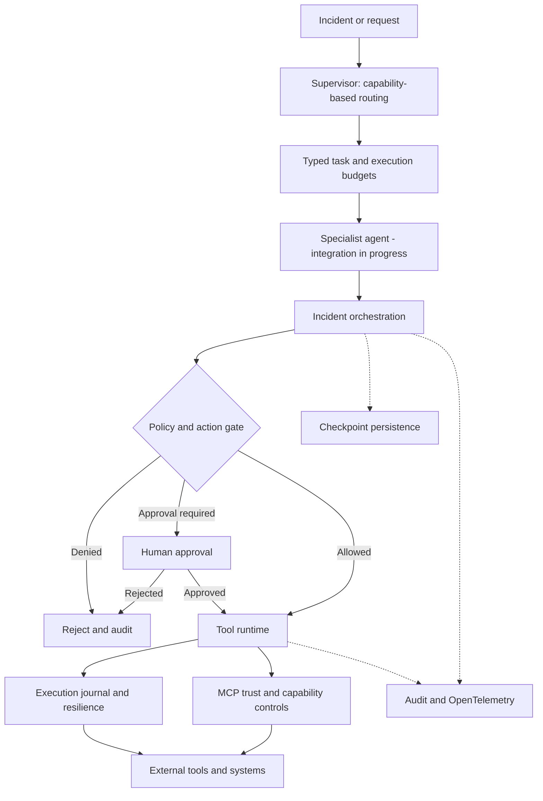

# AegisOps

**A governed control plane for agentic incident response**

[](https://www.python.org/)
[](#project-status)

AegisOps is a Python engineering project focused on a difficult part of agentic AI: **how to let agents investigate problems and propose actions without letting model-generated output bypass operational controls**.

The project separates agent routing, authorization, human approval, tool execution, durable state, auditability, and observability. The goal is to explore reliable, accountable agent-assisted operations—not to present a prototype as a production-certified autonomous SRE platform.

> **Status:** Active development. The repository contains control-plane modules and automated tests. A fully integrated specialist-agent execution system and production deployment are not yet established.

## Why AegisOps?

An agent that can call a tool is not automatically an agent that should be trusted to change infrastructure. Real incident response raises questions that basic agent demos rarely answer:

- Can an agent execute a remediation that policy forbids?
- How is approval required and recorded for a high-risk action?
- What happens when a worker crashes after sending a non-idempotent request?
- Can an untrusted MCP server define its own permissions?
- Can engineers reconstruct the decision path across an incident, agents, and tools?

AegisOps addresses these concerns through **application-enforced controls**. Agent-generated text is treated as a proposal, not as authorization.

## Architecture



*Conceptual integration diagram.* Several components are implemented as modules with tests; the complete end-to-end agent lifecycle remains a development objective.

## Implemented engineering components

| Area | Modules | Purpose |
| --- | --- | --- |
| Agent contracts | `agent_contracts.py` | Typed agent specs, tasks, evidence, findings, and results |
| Supervisor | `supervisor.py` | Deterministic routing by capabilities, action permissions, and budgets |
| Policy and approval | `policy.py`, `action_gate.py`, `approval.py` | Keep authorization outside agent reasoning |
| Orchestration | `orchestrator.py` | Coordinate incident and action flow |
| Tool execution | `tool_runtime.py`, `resilience.py` | Registered tools, limits, retries, and circuit-breaker controls |
| Durable state | `checkpoint.py`, `execution_journal.py` | Persist checkpoints and track side-effect execution attempts |
| MCP governance | `mcp_trust.py`, `mcp_registry.py` | Validate tool boundaries and application-owned capabilities |
| Observability | `observability.py`, `otel.py` | Trace and correlate operational activity |
| Audit | `audit.py` | Record and verify operational events |

These modules provide the foundation; the table does **not** imply that every capability is wired into one deployed service.

### Agent routing

The supervisor evaluates an agent's declared capabilities, permitted action types, deadline, and step budget before preparing a typed task. Routing is deterministic and tested. **Dispatch currently constructs and validates a task; it does not itself run a specialist model or perform remediation.**

### Authorization and human control

Proposed actions pass through policy and action-gating logic. The design separates **proposal**, **policy decision**, **approval**, and **execution**. A model or MCP server cannot grant itself permissions simply by describing an operation as safe.

### Durability and replay safety

SQLite-backed checkpoints and an execution journal help track state, worker claims, and uncertain outcomes. **This is not a blanket exactly-once guarantee.** External side effects still require idempotency contracts, reconciliation, and appropriate transactional design.

### MCP security

MCP interactions are governed by application-defined trust and capability controls, with schema validation and explicit tool/server restrictions. External tool output remains untrusted data; content labelling alone is not a complete prompt-injection defense.

### Observability

The project uses OpenTelemetry-compatible tracing and correlation concepts to support inspection across incidents, actions, and tools. A hosted tracing backend is not required for the core test suite.

## Repository layout

```text
AegisOps/
├── src/
│   └── aegisops/       # Agent contracts, supervisor, policy, tools,
│                      # MCP trust, checkpoints, audit and tracing
├── tests/              # Automated Python tests
├── pyproject.toml      # Package metadata, dependencies and tooling
├── .gitignore
└── README.md
```

Browse the [implementation](src/aegisops) or [tests](tests) for the source of truth.

## Getting started

**Requirements:** Python 3.11 or newer and Git.

Clone the project:

```bash
git clone https://github.com/SwapnilMundhekar/AegisOps.git
cd AegisOps
```

Create and activate a virtual environment on **Windows CMD**:

```bat
py -3.12 -m venv .venv
.venv\Scripts\activate
```

On **Linux or macOS**:

```bash
python3 -m venv .venv
source .venv/bin/activate
```

Install the development dependencies:

```bash
python -m pip install --upgrade pip
python -m pip install -e ".[dev]"
python -m pip check
```

Run the tests:

```bash
python -m pytest -q
```

Run the supervisor tests specifically:

```bash
python -m pytest tests/test_supervisor.py -v
```

For coverage details:

```bash
python -m pytest --cov=aegisops --cov-report=term-missing
```

The test suite does not require credentials for a real production infrastructure environment. Passing unit tests is not equivalent to an audited production deployment.

## Technology choices

- **Python and Pydantic:** typed domain objects and validation.
- **SQLite:** local durable checkpoints and execution records.
- **MCP and JSON Schema:** interoperable tool contracts with application-side validation.
- **OpenTelemetry:** trace context and instrumentation.
- **pytest, Ruff, mypy:** automated testing and static analysis tooling.
- **FastAPI, LangGraph, OpenAI Agents SDK:** declared project dependencies; their presence does not imply that every deployment or integration path is complete.

See [`pyproject.toml`](pyproject.toml) for the definitive dependency list and supported Python version.

## Project status

| Capability | Current status |
| --- | --- |
| Typed agent contracts and supervisor routing | Implemented; supervisor tests pass |
| Policy, approval, tool runtime and resilience modules | Implemented; integration scope varies |
| SQLite checkpoints and execution journal | Implemented as project modules |
| MCP trust boundary and capability registry | Implemented as project modules |
| Audit and OpenTelemetry adapters | Implemented as project modules |
| Specialist-agent execution dispatcher | Planned |
| End-to-end multi-agent incident response | In progress |
| Distributed production deployment and independent security audit | Not established |

## Engineering roadmap

1. **Agent execution:** asynchronous specialist invocation, bounded concurrency, timeouts, typed results and handoff validation.
2. **Quality gates:** CI tests, linting, typing, coverage reporting and security checks.
3. **Operational hardening:** persistent distributed coordination, reconciliation, authentication and secrets management.
4. **Evaluation:** task success, tool-selection accuracy, policy violations, prompt-injection resistance, latency and token costs.
5. **Deployment:** containerized services, durable production storage and operational dashboards.

## Security and limitations

AegisOps is an **experimental engineering project**. Do not connect it to production infrastructure with unrestricted credentials. Use least-privilege tool access and independent human approval for consequential operations. Recovery controls, policy checks and audit trails improve safety but do not eliminate operational risk.

## Author

**Swapnil Mundhekar** — AI Engineering · Python · Agentic AI · LLMOps

[GitHub profile](https://github.com/SwapnilMundhekar)

---

*AegisOps — agentic operations that are governed, observable, and recoverable by design.*
